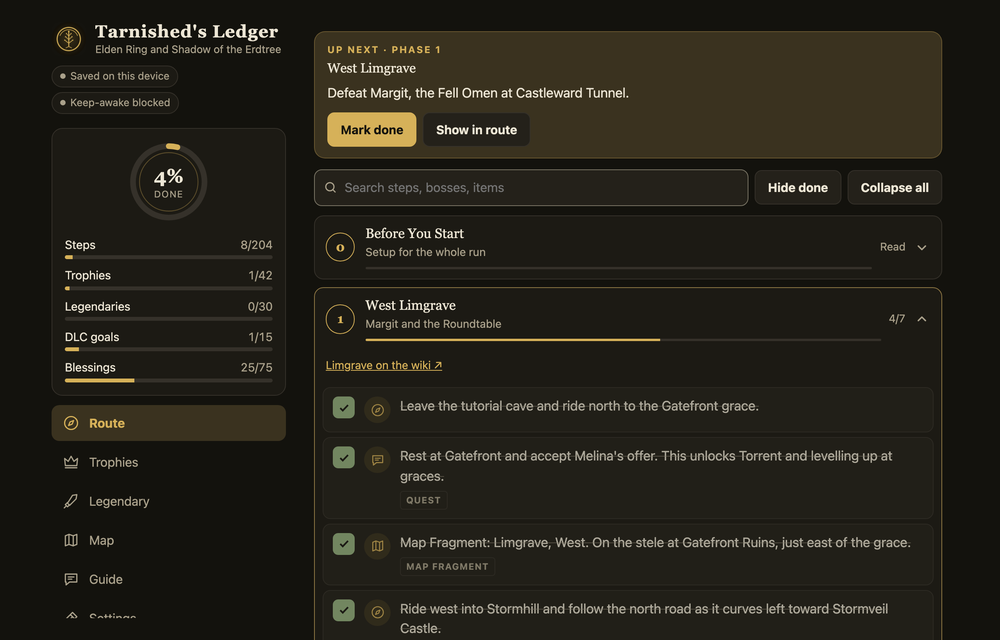
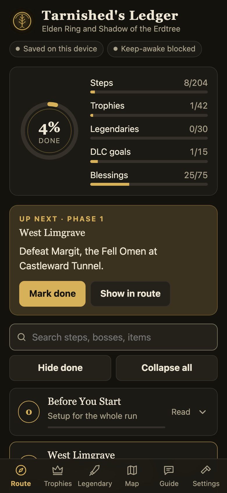
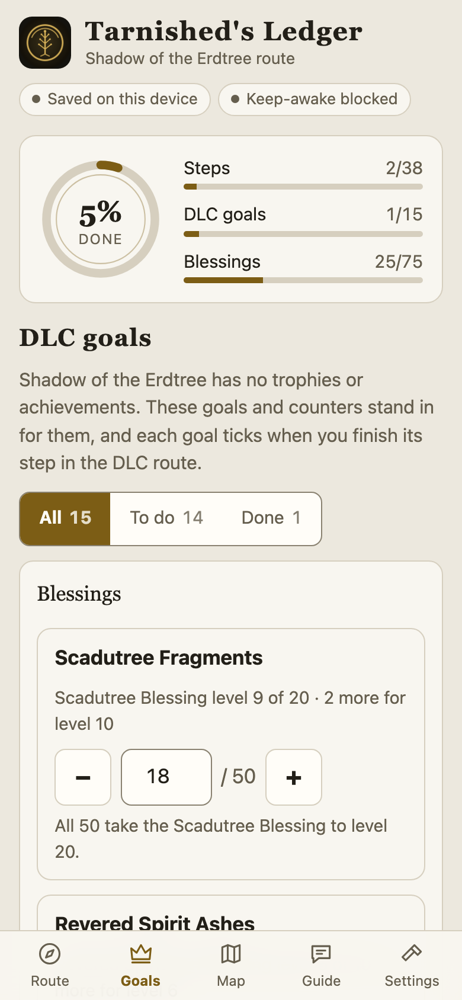
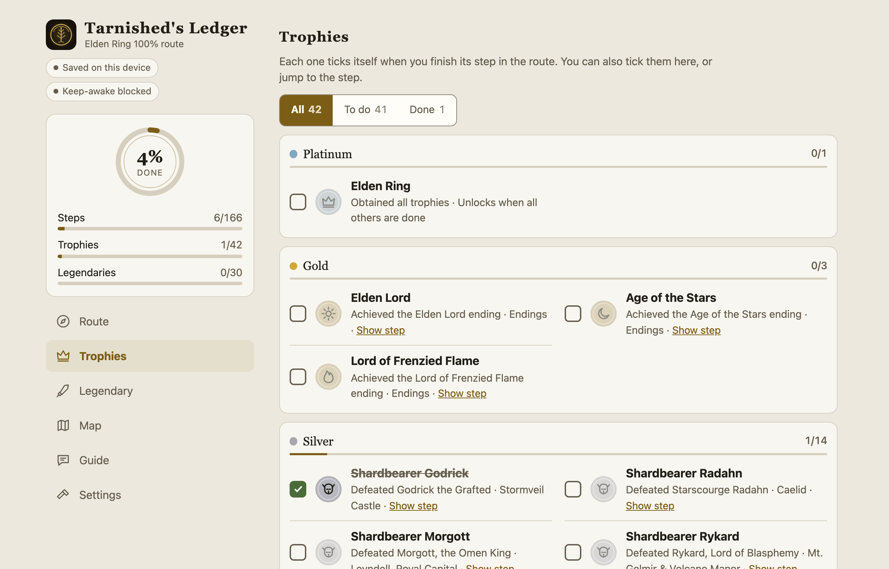

<div align="center">


# Tarnished's Ledger

**A step-by-step 100% completion checklist for Elden Ring, with Shadow of the Erdtree tracking.**
Installable, offline-ready, no account, no build step.

[](https://dsameendra.github.io/tarnished-ledger/)
[](https://github.com/dsameendra/tarnished-ledger/actions/workflows/ci.yml)


</div>

<p align="center">
  
</p>

## What it is

One ordered route through the Lands Between that gets you all 42 trophies and achievements: every boss, every legendary item and all three ending trophies. You tick steps as you play and the app does the bookkeeping: which trophy a step completes, what to do next, and how far along you are.

Shadow of the Erdtree can be switched on in Settings. The DLC has no trophies, so it is tracked as a route of 12 phases with goals and blessing counters instead.

## Features

- **25 route phases** of tick-off steps with an "Up next" card, search, collapsible phases and "hide done".
- **Trophy list** with PlayStation medals (or Xbox/PC achievement wording) that tick themselves from the route.
- **Legendary items** tracker: armaments, ashen remains, spells and talismans.
- **Shadow of the Erdtree** (optional): 12 DLC phases, 15 completion goals, and Scadutree Fragment and Revered Spirit Ash counters with blessing levels. A "DLC only" mode hides the base game.
- **Guide tab**: easy-to-miss content, Stonesword Key uses, upgrade costs, the endings and how to back up your save on each platform.
- **Interactive map** of the Lands Between, underground regions and the Realm of Shadow: pan, pinch and zoom, layers, marker filters, search, place names, an overview map and a full screen view.
- **Sync between devices** through a private GitHub gist (optional), plus file and code backups.
- **Works offline** and installs as an app on iPhone, Android and desktop. Can keep the screen awake while you play.
- **Themes**: system, light and dark, four accents, three text sizes, compact rows.

<table>
  <tr>
    <td></td>
    <td></td>
    <td></td>
  </tr>
</table>

## Use it

Open **https://dsameendra.github.io/tarnished-ledger/**.

**iPhone:** open the site in Safari, tap Share, then Add to Home Screen. An installed home-screen app has its own storage, separate from Safari, so use sync or a backup to move progress across. Keeping the screen on needs iOS 18.4 or later.

**Android / desktop Chrome:** use the browser menu, then Install app.

Progress is stored in your browser. To use it on several devices, connect the optional gist sync in Settings. See [docs/SYNC.md](docs/SYNC.md) for how it works and the alternatives.

## Run it locally

There is no build step.

```bash
git clone https://github.com/dsameendra/tarnished-ledger.git
cd tarnished-ledger
npm run serve          # python3 -m http.server 8080
```

Open http://localhost:8080. The service worker only registers over HTTPS or localhost.

```bash
npm run check          # validates the route data
npm test               # unit tests for the store and sync logic (Node 20+, no dependencies)
```

## How it is built

Plain ES modules, `localStorage` and a service worker. No framework, no bundler, no runtime dependencies.

| Path | Purpose |
|---|---|
| `index.html`, `css/styles.css` | App shell and styles |
| `js/app.js` | Boot and event wiring |
| `js/lib/` | Store, sync, derived model, icons and helpers |
| `js/ui/` | One module per tab |
| `js/data/` | Route, trophies, map, guide and DLC data |
| `sw.js`, `manifest.webmanifest` | Offline cache and install metadata |
| `scripts/`, `test/` | Data checks, map calibration and data build scripts, unit tests |
| `vendor/leaflet/` | Leaflet 1.9.4 (BSD-2), loaded when the Map tab opens |
| `assets/map/` | Map art and marker data (see Credits) |
| `docs/` | Architecture, map viewer and data, sync options, deployment |

Read [docs/ARCHITECTURE.md](docs/ARCHITECTURE.md) for the design, [docs/DATA.md](docs/DATA.md) for the route format and how to add a phase, and [docs/DEPLOY.md](docs/DEPLOY.md) for releasing.

## Contributing

Corrections to the route are very welcome. Open an issue with the step, what is wrong and a link to a source, or send a pull request. Please only add game facts you can verify, run `npm run check` and `npm test`, and keep the code in the existing style. See [CONTRIBUTING.md](CONTRIBUTING.md).

## Credits

The base-game route follows the community [Elden Ring 100% Achievement Guide by ponkberry](https://steamcommunity.com/sharedfiles/filedetails/?id=2785187510) on Steam. Shadow of the Erdtree facts were checked against the Elden Ring wiki. Icons, trophy medals and the map marker glyphs are original drawings. The Map tab uses map images made from in-game map screenshots and marker data from MapGenie's public data (see `docs/MAP-DATA.md`); that artwork belongs to its owners and is used here in an unofficial fan project.

## Disclaimer

Unofficial fan project. It is not affiliated with or endorsed by FromSoftware, Bandai Namco or Sony. Elden Ring and related names, characters and artwork, including the in-game map art shown in the Map tab, are trademarks and copyrights of their owners.
